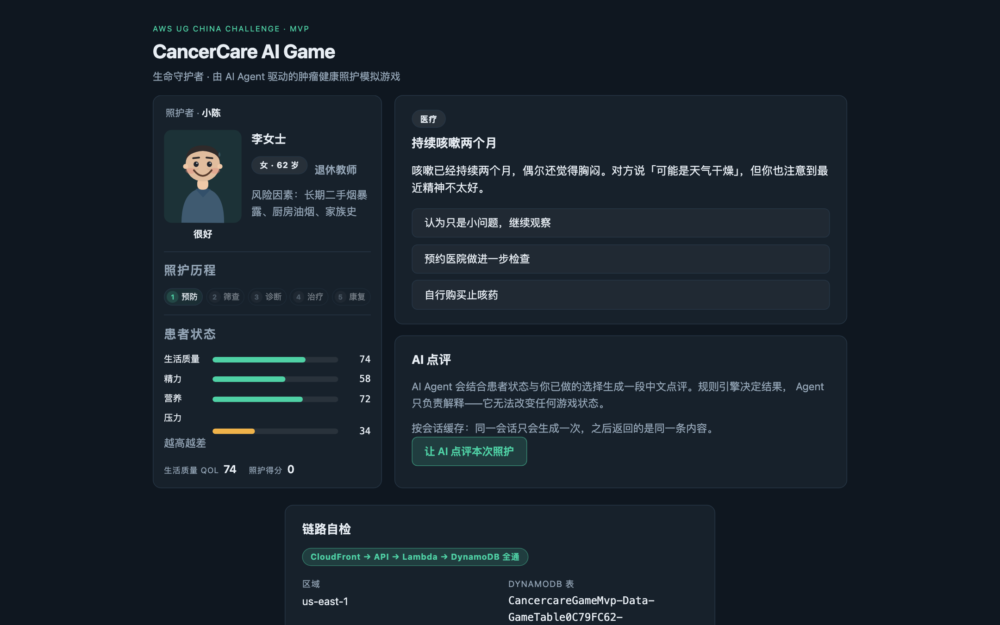
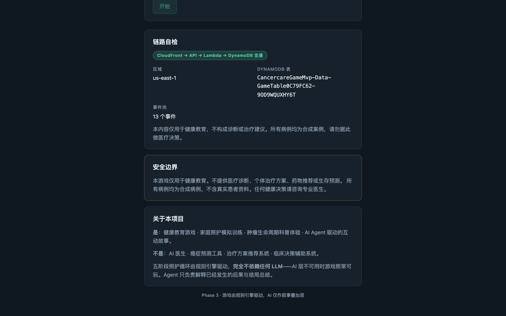
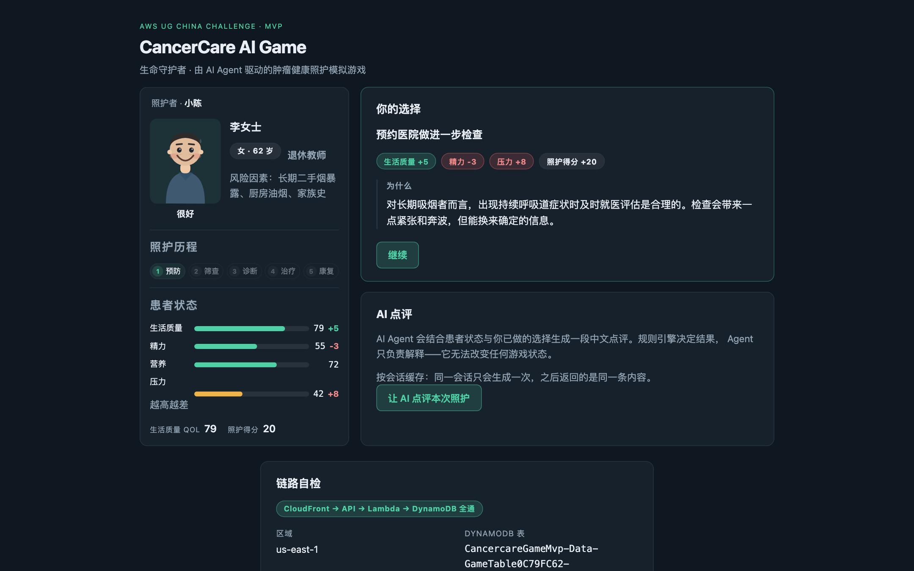
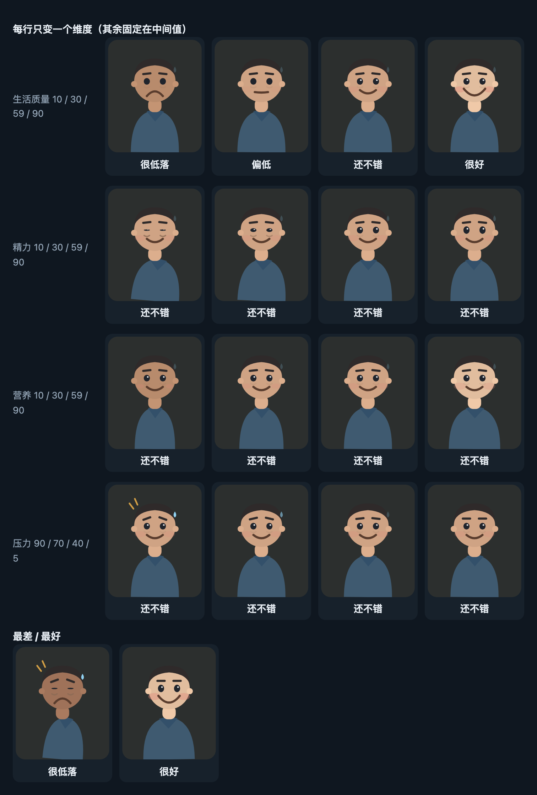
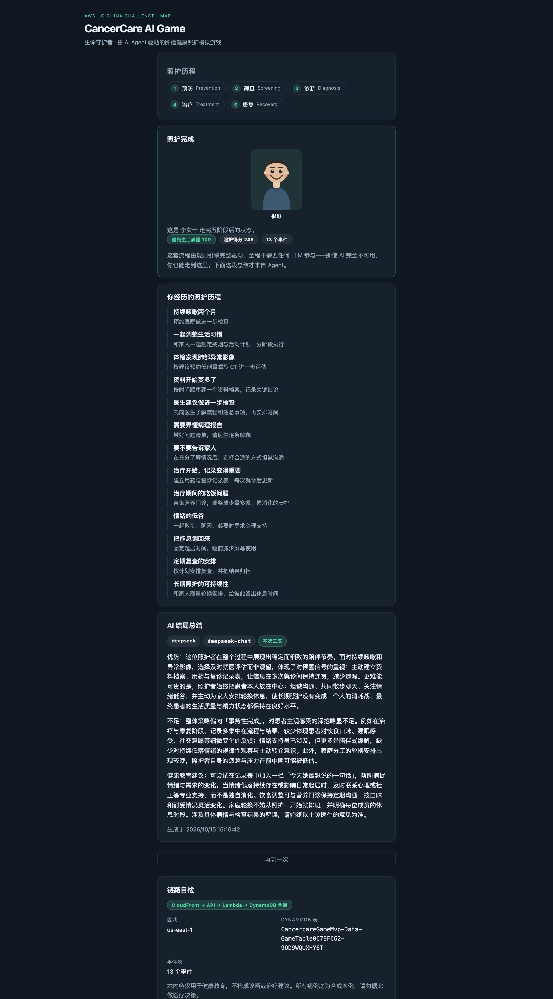

# 用 AWS Bedrock AgentCore 做一个照护模拟小游戏

## 架构选择与九条实战踩坑

本文以 [`cancer-care-ai-game`](../README.md) 这个真实跑起来的项目为例，讲一套「无服务器 API + 单表 DynamoDB + AgentCore」的组合在落地时的架构取舍与使用要点。

游戏本身只是外壳：玩家扮演家庭健康守护者，陪一位**合成病例**患者走完预防、筛查、诊断、治疗、康复五个阶段，每阶段回答若干情境题，目标是把患者的生活质量（QoL）提上去。真正的技术看点在于——**这套系统的核心玩法完全不依赖大模型**，Agent 只是一个可选的叙事叠加层。这个约束决定了后面所有的设计。



*游戏主界面。左侧患者的形象会随四个健康维度实时变化——这正是「把数值变成直觉」的那一层；右侧是规则引擎给出的事件与选项。两边同屏，选的时候能直接看到患者脸色的变化。*

> 安全边界：本项目是健康教育游戏，不提供诊断、个体治疗方案、药物推荐或生存预测。所有病例均为合成数据。

---


## 一、整体架构

```
浏览器
  |
  v
CloudFront (OAC, 签名回源)
  |-- 默认路径  -> S3   静态前端
  |-- /api/*    -> API Gateway (HTTP API v2) -> Lambda (Node 22 / ARM64) -> DynamoDB
  |
Lambda --(InvokeAgentRuntime)--> AgentCore Runtime (Python, ARM64)
                                     |-- AgentCore Memory  (玩家长期偏好)
                                     `-- DeepSeek / Bedrock  (可插拔 provider)
```

四类资源，四个 CDK 栈（`CancercareGameMvp-{Data,Agent,Api,Frontend}`），依赖方向是单向的：

```
Data -> Agent -> Api -> Frontend
```

几个具体的选型理由，都是踩过才知道的：

**为什么用 CloudFront 的 OAC 而不是 S3 静态网站端点。** OAC 下桶不需要公开，CloudFront 用签名请求回源。代价是缺失对象会返回 403 而不是 404（桶不授予 `s3:ListBucket`，S3 对缺失 key 返回 AccessDenied，CloudFront 原样透传）。这个取舍值得明确记录：关键性质是**缺失资源不会被伪装成 200 的 `index.html`**，而不是状态码本身好不好看。

**为什么 `/api/*` 走 CloudFront 反代而不是让前端直连 API Gateway。** 同源，因此没有 CORS 预检，前端代码里的 API 基址是一个相对路径 `/api/v1`。同一个相对路径在本地开发时由 Vite dev server 代理、在生产由 CloudFront 代理，**构建产物里不需要烘焙任何 API 地址**，也就没有构建顺序依赖。

这里有个容易踩的配置：CloudFront 默认会把 viewer 的 `Host` 头转发给源站，而 API Gateway 只接受自己的域名，结果是一律 403。必须用 `originRequestPolicy` 排除 `Host` 头。冒烟脚本里专门有一项检查就是为它准备的。

**为什么 Lambda 超时是 29 秒。** API Gateway HTTP API 的集成超时约 30 秒且不可配置。整个链路上每一层都要比上一层短：Lambda 29 秒 < API Gateway 30 秒，Agent 侧调用模型 20 秒 < Lambda 29 秒。这样一层超时会以「上游超时」这种干净的错误暴露出来，而不是一个语焉不详的网关 504。

这条链路上任何一环断掉，页面底部这一栏都会如实反映出来——它本身走的就是「CloudFront → API Gateway → Lambda → DynamoDB」这条完整路径：



*页面下滑后的「链路自检」卡片。它的绿标是一次真实请求的结果，不是装饰——如果 API、Lambda 或表有任何一环不可用，这里会直接显示失败与状态码。*

---

## 二、几个决定了整个系统的设计决策

### 1. 规则引擎与 LLM 彻底解耦

事件池、选择判定、状态演进全部由一个**纯函数**规则引擎完成，它不 import 任何 AWS SDK，也不调用任何模型。玩家做的每一个选择，「造成什么后果」是查表算出来的，不是模型生成的。

LLM 只负责两件事：解释已经发生的后果，以及在通关时写一段总结。



*做出选择后的那一刻。影响与解释都来自规则引擎——`rationale` 是事件模板里的静态文本，不是模型生成的，所以同一个选择在任何时候、任何部署里都给出同样的解释。*

这样做的直接好处是：**AI 层挂掉，游戏照常可玩**。这不是理论上的好处——冒烟脚本里 42 项检查全部不经过模型，完整通关一遍五阶段也完全不碰 Agent。叙事接口返回 502 时，游戏的状态更新、事件时间线、阶段推进一切正常。

顺带的好处是成本与延迟可控：一次完整游玩的核心流程是零模型调用。

### 2. DynamoDB 单表 + 稀疏索引 + 四项原子事务

单表设计，`PK`/`SK` 加一个**稀疏** GSI：

| 条目 | PK | SK |
|---|---|---|
| 玩家 | `PLAYER#<id>` | `PROFILE` |
| 会话 | `SESSION#<id>` | `META` |
| 患者状态 | `SESSION#<id>` | `PATIENT#<patientId>` |
| 事件历史 | `SESSION#<id>` | `EVENT#<timestamp>#<eventId>` |
| 叙事缓存 | `SESSION#<id>` | `NARRATION#<kind>` |
| 会话索引 | 带 `GSI1PK`/`GSI1SK` | |

「一次会话的全部内容都在同一个分区里」，所以读一个会话是一次 Query 而不是 N 次 GetItem。

索引是稀疏的：只有会话条目带 GSI 键，玩家和事件条目**在类型上就写不出**这两个字段。这一点是刻意的——DynamoDB 拒绝空字符串作为键属性，所以「把不需要的索引键置空」这个做法根本不可行，唯一可靠的办法是让错误无法被表达。这一点有测试守着。

提交一次选择是一个**四项原子 `TransactWrite`**：

1. 更新患者状态，条件 `#version = :expectedPatientVersion`；
2. 更新会话，条件 `#version = :expectedSessionVersion`；
3. 标记事件已作答，条件 `attribute_not_exists(chosenChoiceId)`（幂等保护）；
4. 必要时写入下一个事件，条件 `attribute_not_exists(PK)`。

两个乐观锁是必要的，因为患者状态与会话是可独立变更的两份数据；幂等条件则是为了让重复提交返回 409 而不是把状态改两遍。`TransactWrite` 的条件表达式失败会返回 `TransactionCanceledException`，其 `CancellationReasons` 是按位置对应的——把它包装成带下标的错误（`[2] ConditionalCheckFailed`）能省下大量排查时间。

### 3. 同一份数据，两套取值语义

健康值有四个维度（生活质量、精力、营养、压力），都约束在 0-100。系统里有两个函数处理增量，**它们的语义故意不同**：

- `clampHealth(current, delta)` —— 引擎内部使用，越界即**截断**。玩家的选择结果是既定事实，不该因为超出范围而失败；
- `applyValidatedDelta(current, delta)` —— 用于**外部提议**，越界即**抛错拒绝**。

为什么不能只留一个？如果对 Agent 的提议做截断，它会以为 `stress: +999` 被接受了（实际只生效了 +40），然后基于一个错误的世界认知继续推理。拒绝才能让提议方知道要重来。测试里有一组专门的用例，断言同一个越界输入在两个函数下得到相反的结果——把这个分歧钉在文档里，而不是留给后人猜。

---

### 4. 数值给人的那一层：一个纯映射的视觉层

同一份健康状态，有两个消费者：机器读数值，人看形象。后者是一个不依赖任何模型、不加载任何图片资源的**纯映射**——一个手写的内联 SVG，四个维度各驱动一个可见特征：

| 维度 | 画在哪 |
|---|---|
| 生活质量 | 嘴型（瘪嘴 → 大笑）与气色 |
| 精力 | 眼睛开合、眼下阴影、体态倾斜 |
| 营养 | 肩宽与脸颊丰满度 |
| 压力 | 眉形（内侧上挑）、汗滴、紧张符号 |



*每行只变一个维度、其余固定在中间值，所以每一行的差异就是该维度的差异。左下是各项最差，右下是各项最好。*

两个实现上的决定值得记下来：

- **所有会变的属性都必须是 CSS 可过渡的**（`fill` / `transform` / `opacity`），不能换 `path`。这样一次选择的后果是「脸上慢慢变过去」，而不是硬切。同理，反应动画用 class 切换而不是组件重挂载——重挂载会让过渡失去起始值。
- **映射用离散档位**（25 / 45 / 70）而不是连续值。一张脸只能表达四档表情，把 61 和 64 映射成不同的眉毛只会制造没有含义的视觉噪声。

顺带一个真实的教训：这张对照图本来是用来核对画得对不对的，结果它立刻暴露了一个实现缺口——第一版里「营养」那一行四个格子几乎一模一样，因为我在映射模块里写了它该影响丰满度，画的时候却只让它改了肤色。**用一张把所有变量逐个隔离的对照图来验收映射类逻辑，比逐个状态点开看有效得多。**

---

## 三、AgentCore 部分

先把这一层产出的东西摆出来，后面所有设计讨论都围绕它：



*走完五阶段后的完成页。上面全部由规则引擎与 DynamoDB 产生——时间线里的每一次选择、每个事件，都是可回放的事实。最下方那一段「优势 / 不足 / 健康教育建议」才是 Agent 的产出，它是这件事的**读者**，不是作者。*

### Runtime 与 Memory

AgentCore Runtime 跑一个 Python Agent（`BedrockAgentCoreApp`，监听 8080，`POST /invocations`）。几个必须注意的属性：

- **只支持 ARM64**。开发机通常是 x86_64，所以打包是交叉构建，见下一节的坑。
- **网络用 public**。Agent 要访问外部的模型 API，走 VPC 就得配私有子网加 NAT 网关，为同样的可达性付出多得多的复杂度。
- **入站认证用 IAM**，不用默认的 Cognito——被调用方是同账号的 Lambda，不需要用户池。

Memory 用两个策略（用户偏好 + 语义），命名空间是自定义的 `/players/{actorId}`。这里有个细节值得单独说：

内置命名空间模板是 `/strategies/{memoryStrategyId}/actors/{actorId}`。`{memoryStrategyId}` **只有服务端在写入时才知道**，读的一方拿不到它，也就无法拼出检索路径——而检索 API 要求传入字面量命名空间。所以必须换成自己定义的路径。这个坑不看文档读到底很难发现：写入一切正常，读取永远为空。

### 可插拔的 provider

模型调用抽象成一个极小的接口（一个 `complete(system, user) -> str`），两个实现：`DeepSeekProvider`（直连官方 API）与 `BedrockProvider`（走 `bedrock-runtime`）。用一个环境变量切换。

这不是过度设计，是被现实逼出来的：**本账号被 Bedrock 的模型 allowlisting 阻断**，`InvokeModel` 直接被拒并指向支持工单，而这是账号级门槛，任何 IAM 策略都绕不过去。把 provider 做成可插拔，就把它从「阻塞项」降级成了「一个可选项」。文中所有实测数据都来自直连 provider 那条路。

### 安全边界：Agent 不持有任何数据库权限

这是整个项目最重要的一条设计，也是最容易被无意破坏的一条：

> **Agent 的执行角色不持有任何 DynamoDB 权限。**

Agent 想改游戏状态，唯一的路径是调用工具，而工具是校验发生的地方（边界、阶段合法性、内容安全过滤都在那里）。一旦给执行角色授予 `dynamodb:*`——哪怕理由是「只是想读一下状态」——这条边界就会无声地塌掉：乐观锁、边界校验、安全过滤会同时失效，而且**没有任何机制会报警**。

这条不变量有一个测试断言它在合成模板里成立。有意思的是，这类「证明某权限不存在」的断言比「证明某权限存在」的断言更有价值——后者通常会在部署时以报错的形式自己暴露，前者不会。

---

## 四、九条实战踩坑

以下每一条都是本项目实际撞到的，附带真实报错。

### 1. ARM64 交叉打包必须禁止源码分发

Runtime 只接受 ARM64。在 x86_64 开发机上交叉打包时，如果只用 `pip install`，**pip 会在没有预编译 wheel 时静默回退到下载源码包并在本机编译**，产出一个架构错误的 zip。它不会报错，直到运行时才以 `exec format error` 炸出来。

```
uv pip install --target "$BUILD_DIR" \
  --python-platform aarch64-manylinux2014 \
  --python-version 3.13 \
  --only-binary :all: \        # <-- 关键：宁可失败，也不要源码编译
  -r requirements.txt
```

`--only-binary :all:` 让「没有对应的预编译包」变成一个**构建期失败**而不是运行期炸雷。再补一道保险：打包前逐个 `file` 校验 `.so` 的架构，发现非 ARM64 就中止。

### 2. Runtime 的 X-Ray 投递依赖一个账号级设置

部署 Agent 栈时，`AWS::Logs::Delivery` 直接失败：

```
X-Ray Delivery Destination is supported with CloudWatch Logs as a
Trace Segment Destination. Please enable the CloudWatch Logs destination
for your traces using the UpdateTraceSegmentDestination API
```

也就是说，AgentCore Runtime 的 trace 要投递到 CloudWatch Logs，前提是**账号级**把 X-Ray 的 trace segment destination 切成 CloudWatch Logs。这个设置在 CDK 模板里完全看不出来，而且它是账号级的——会同时搬走同账号下其他项目的 trace。

结论：这类投递**不该默认打开**。本项目现在由 `config.agentTracing` 控制、默认关闭，并在注释里写清了开启的前提。

### 3. L2 构造没授予的权限只在部署期的 CloudTrail 里现形

第一次部署 Agent 栈失败后，`cdk diagnose` 报出另一处问题：

```
GameMasterExecutionRole: AccessDenied on logs.amazonaws.com:PutResourcePolicy
```

AgentCore 服务在创建 Runtime 时，会对**自己那个日志组**调用 `logs:PutResourcePolicy`，而 CDK 的 L2 构造并不授予它。这类缺失有两个特点：模板上看不出任何异常，测试也测不出来，只有在部署期从 CloudTrail 里才能发现。

按官方执行角色文档补上，作用域限定到该 Runtime 的日志组：

```
arn:aws:logs:us-east-1:<account>:log-group:/aws/bedrock-agentcore/runtimes/<agentName>-*
```

顺带一个自己写出来的坑：日志组名本身以 `/` 开头，用 CDK 的 `Arn.format` 生成 ARN 时若不加 `arnFormat: ArnFormat.COLON_RESOURCE_NAME`，会渲染出 `log-group//aws/...` 这种双斜杠，**而它看起来「包含正确的路径前缀」，宽松的断言根本拦不住**。最后是把断言收紧成精确匹配才发现的。

### 4. 传了 `runtimeUserId` 就得换一个 IAM 动作

调用 Runtime 时传入 `runtimeUserId`（为了让 Memory 按玩家隔离），要求的动作就从 `InvokeAgentRuntime` 变成了：

```
bedrock-agentcore:InvokeAgentRuntimeForUser
```

只授予前者会**部署成功、每次调用失败**。错误信息很直白地指出了缺哪个动作，值得庆幸；但这类「构建期一切正常、运行期必错」的权限，最好在栈测试里钉死两个动作都在。

顺带：调用失败原本会冒泡成一个 500，被包装成 502「上游不可用」更准确——对游戏来说这就是一次可降级的 AI 不可用，而不是后端故障。

### 5. 命名约束在不同资源之间不一致

| 资源 | 命名约束 | 连字符 |
|---|---|---|
| Runtime / Memory | `^[a-zA-Z][a-zA-Z0-9_]{0,47}$` | 不允许 |
| Gateway | `^([0-9a-zA-Z][-]?){1,48}$` | 允许 |

项目短名是 kebab-case，所以 Runtime/Memory 的名字要转写成下划线，**而 Gateway 不能这么做**。这个不一致带来一个隐蔽的风险：把转发函数顺手用在 Gateway 上不会报错，只是名字变了；反过来则会变成 synth 期的校验错误。结论是给两个用途各留一个命名助手，别共用一个。

### 6. 构建产物必须先于 synth 存在

CDK 在 synth 阶段就要读资产文件：前端的 `dist/` 与 Agent 的 `game-master.zip`。缺了它们，synth 会以一个**与真正原因毫不相关的资源错误**失败。部署指南里把这一点单独标注，并把「先构建、后 synth」写进了部署顺序。

### 7. 凭据放 SSM，不要放环境变量

模型的 API key 存在 SSM Parameter Store 的 `SecureString` 里，运行时用 `ssm:GetParameter` + `WithDecryption` 取，而不是注入成环境变量。

原因很直接：**Runtime 的环境变量对任何有控制面读权限的人都是可见的**，也会直接显示在控制台上。存 SSM 的代价是多一次运行时调用和一条 `kms:Decrypt` 权限（AWS 托管的 SSM key 也需要显式授予解密）。

### 8. 客户端库的默认区域是个陷阱

`MemoryClient` 的默认区域不是从环境推导的（实测会指向 `us-west-2`），必须显式传 `region_name`。这类默认值不会报错，只会让你的请求安静地打到另一个区域、然后找不到资源。

### 9. 缓存键的粒度会变成产品行为

叙事结果的缓存键是 `(sessionId, kind)`，也就是**每个会话每种类型只真正生成一次**。这个设计本身是合理的（省模型调用、结果稳定），但它会变成用户可见的行为：界面上第二次点「点评这次选择」，拿到的其实是第一次生成的那段文字。

我们的处理是**在界面上如实标注 `cached` 徽标**，而不是把旧文本当作新点评展示。这类「缓存粒度外溢成功能语义」的问题，在演示里比在架构图里更容易被发现——值得为它留一个显式的前端标记，而不是只在后端注释里写一句。

---

## 五、成本与运维要点

- **常驻计费的是 AgentCore 的 Memory 与 Runtime**，不是「有请求才花钱」的那种。演示结束不拆栈就会持续挂账。本项目提供一键 `npm run destroy`。
- `cdk destroy --all` **只作用于本 CDK app 定义的栈**。同账号下别的项目的栈、以及共用的 `CDKToolkit` 不在范围内，不会被误删——这一点在文档里明确写出来，比让人自己推理放心。
- 数据侧的成本控制靠**表级 TTL**（会话 7 天自动过期）与按需计费；同时开启了 PITR，因为「能回到某个时间点」这件事在演示里往往比省下的那点存储费更值钱。
- SSM 的 `SecureString` 标准参数不计费，且**不属于任何 CDK 栈**，所以拆栈后它仍在，下次不必重新写入。

---

## 六、如何自己跑起来

前置：Node ≥ 20、[`uv`](https://docs.astral.sh/uv/)（交叉打包 Python 依赖用）、AWS CLI，以及一个有 AgentCore 权限的账号。完整的权限清单见下一节，或仓库的 [`docs/DEPLOYMENT.md`](DEPLOYMENT.md)。

```bash
# 1. 依赖与两个构建产物（两者都必须先于 cdk synth 存在）
npm run install:all
npm run build:agent        # arm64 zip，交叉打包，无需 Docker
npm run build:web          # 前端 dist

# 2. 一次性准备：模型 key 进 SSM、AgentCore 权限挂到部署身份
#    命令与策略 JSON 见 docs/DEPLOYMENT.md §1

# 3. 部署（顺序由 CDK 解析，也可分栈部署便于定位失败点）
npm --prefix infra/cdk run deploy:agent
npm --prefix infra/cdk run deploy:api
npm --prefix infra/cdk run deploy:frontend

# 4. 端到端验证：基础设施 + 完整通关 + AI 叙事层，共 60 项
./scripts/smoke.sh --full
```

本地开发时前端不需要重新部署，Vite dev server 会把 `/api` 代理到已部署的 API：

```bash
VITE_API_PROXY_TARGET=https://<your-api-id>.execute-api.us-east-1.amazonaws.com npm run dev:web
```

AI 层可以单独验证（首次调用约 10 秒，第二次命中缓存约 1 秒）：

```bash
python3 scripts/narration-check.py https://<your-api-id>.execute-api.us-east-1.amazonaws.com
```

> 演示用的部署随时可能被拆掉——AgentCore 的 Memory 与 Runtime 是常驻计费的。

---

## 七、照这套做，一份检查清单

**部署身份需要的权限**（AgentCore 控制面，建议作为客户管理策略挂载）：

```
bedrock-agentcore:CreateAgentRuntime / GetAgentRuntime / UpdateAgentRuntime / DeleteAgentRuntime / ListAgentRuntimes
bedrock-agentcore:CreateAgentRuntimeEndpoint / GetAgentRuntimeEndpoint / UpdateAgentRuntimeEndpoint /
                   DeleteAgentRuntimeEndpoint / ListAgentRuntimeEndpoints
bedrock-agentcore:CreateMemory / GetMemory / UpdateMemory / DeleteMemory / ListMemories
bedrock-agentcore:CreateGateway / GetGateway / UpdateGateway / DeleteGateway / ListGateways
bedrock-agentcore:CreateGatewayTarget / GetGatewayTarget / UpdateGatewayTarget / DeleteGatewayTarget / ListGatewayTargets
bedrock-agentcore:SynchronizeGatewayTargets
bedrock-agentcore:InvokeAgentRuntime
bedrock-agentcore:TagResource / UntagResource / ListTagsForResource
```

不要用 AWS 托管的 `BedrockAgentCoreFullAccess`——它含有 `InvokeAgentRuntimeCommand`，该动作可以在 Runtime 的 microVM 内以 root 执行 shell 并读取执行角色的凭据。

**调用方（Lambda 或其他）需要**：`bedrock-agentcore:InvokeAgentRuntime`，以及传 `runtimeUserId` 时额外需要 `bedrock-agentcore:InvokeAgentRuntimeForUser`。

**执行角色需要**：读密钥（`ssm:GetParameter` + `kms:Decrypt`）、Memory 数据面、模型调用，以及 `logs:PutResourcePolicy`（限定到自己的日志组）。**不需要任何 DynamoDB 权限。**

**资产顺序**：先 `build:web` 与 `build:agent`，再 `cdk synth`。

**已知未做**：本项目**没有鉴权**（拿到 URL 即可游玩），Gateway 工具面按设计跳过，前端是最小可玩版。这三条都写在 README 的「已知限制」里，不藏着。

---

## 结语

如果只记一件事：**把「可演示」和「架构正确」分开判断**。

本项目的 Gateway 工具面在架构上是正确的下一步——它能把「Agent 只能通过工具改状态」这条边界真正封死——但它的未知量最集中（工具名分隔符在文档之间互相矛盾、响应信封形状无法确认、没有现成的 CLI 命令可验证），而收益集中在架构图里，不在屏幕上。于是它被明确地推迟，并写下理由，而不是留成一条含糊的待办。

同理，「规则引擎与 LLM 解耦」这个决定，让这套系统在 AI 完全不可用时依然是一个完整的、可演示的产品。把 LLM 放在关键路径上很容易，把关键路径从 LLM 上摘下来需要一点坚持——但正是这一点让演示变成了可控的事情。
